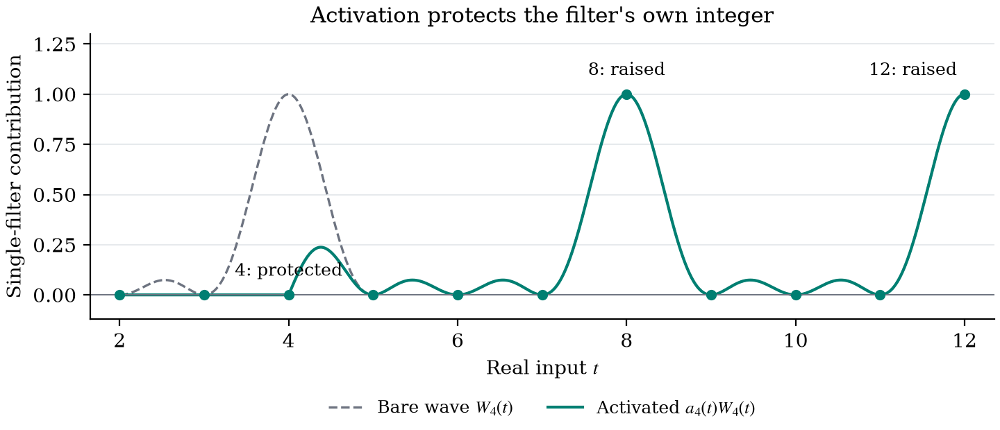
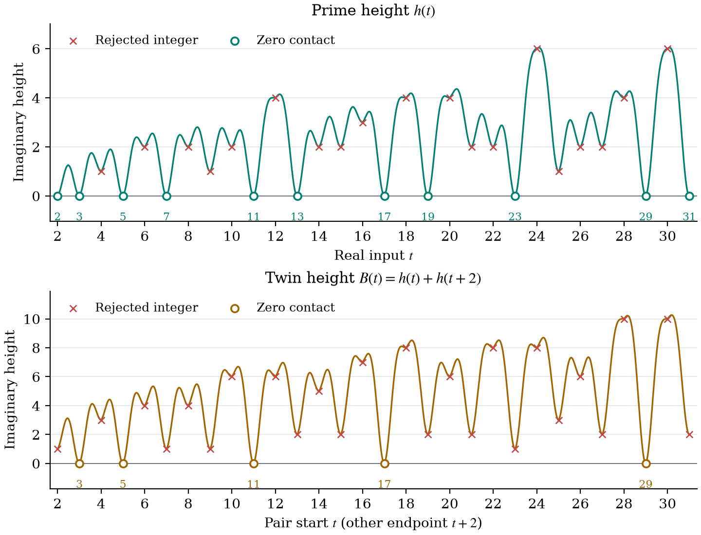
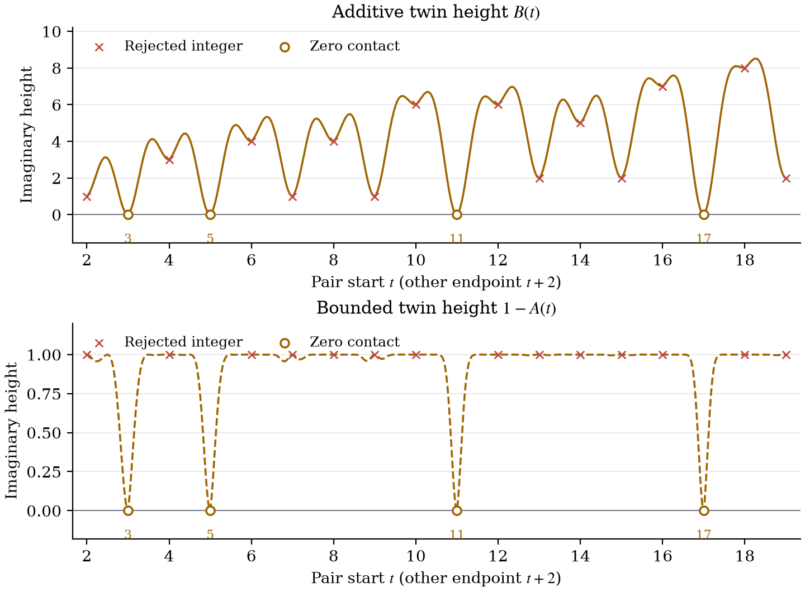

# Continuous Divisor Sieves and Twin-Prime Contacts

**Proof status:** Mathematical draft.

**Author:** Thiago Henrique Ramos da Mata  
Independent Researcher  
**Email:** [thiago.henrique.mata@gmail.com](mailto:thiago.henrique.mata@gmail.com)  
**ORCID:** [0009-0002-7366-939X](https://orcid.org/0009-0002-7366-939X)  
**GitHub:** [@thiagomata](https://github.com/thiagomata)  
**License:** [CC BY 4.0](https://creativecommons.org/licenses/by/4.0/)

## Abstract

<div align="justify">
<p style="text-align: justify">

We construct a continuous complex-valued sieve by adding a normalized
Fejér wave at every integer filter. Each wave raises imaginary height at the
filter's later multiples while preserving its own integer. We prove that the
infinite sum stabilizes exactly on every bounded interval and that its
real-axis contacts are precisely the primes. At integer inputs, the height
is the number of positive divisors minus two.

Applying the same waves at two shifted endpoints gives a continuous curve
whose real-axis contacts are precisely twin-prime starts. We establish
finite-stage certification, divisor-height laws, translated-wave folding
with an explicit activation correction, and a bounded product with the same
pair contacts. Together, these properties give exact continuous
representations of the integer filters and their joint contact condition.
The proofs are mathematical and are not Stainless-verified. They do not
supply a quantitative estimate for the frequency of twin contacts.

</p>
</div>

## 1. Introduction

Sieving removes an integer when a proper divisor is found. We study the
same operation through imaginary height: retained values remain on the real
axis, while rejected values lie above it. For example, filter $2$ raises the
height at $4,6,8,\ldots$ and preserves $2$ itself. A later filter $4$ raises
the height at $8,12,16,\ldots$, recording another divisor without removing
any new integer contact.

We make this rule uniform by applying filters $2,3,4,\ldots$ in order,
without choosing the primes first. A finite trigonometric wave detects
multiples at integer inputs, and an activation factor protects each filter's
own integer and the earlier curve. We prove that this construction has a
continuous limit, identifies prime values exactly, and gives a direct pair
construction for twins. The additive height retains divisor information;
a complementary product gives the same pair contacts with bounded height.

The selective waves are normalized Fejér kernels, associated with Lipót
Fejér's 1900 work [[1]](#ref1). MIT's exposition [[2]](#ref2), Proposition 173,
specifies the normalization convention. Roots-of-unity orthogonality is
classical; Raya and Eberl [[3]](#ref3) provide a modern formal development.
DLMF [[4]](#ref4), [[5]](#ref5) supplies modern references for the divisor
function and the sieve of Eratosthenes. The complementary indicator product
is the elementary inclusion-exclusion mechanism described by Pollack
[[6]](#ref6). We use these established ingredients and derive the activated
contact properties below; priority of the exact combinations is unassigned.

We prove the following property groups:

- Selective waves, activated updates, and compact stabilization — [§2](#2-preliminaries), [§3](#3-activated-recurrence), [§4](#4-locally-finite-limit).
- Prime contacts, filter redundancy, and finite-stage certification — [§5](#5-prime-contacts), [§6](#6-filter-effects-and-certification).
- Factorization, low heights, square parity, and coprime multiplication — [§7](#7-divisor-height-laws).
- Paired-wave construction and twin contacts — [§8](#8-twin-contacts).
- Translated folding and activation correction — [§9](#9-translated-wave-folding), [§10](#10-activation-correction).
- Bounded twin amplitude and contact agreement — [§11](#11-bounded-twin-amplitude).

## 2. Preliminaries

We use integer filter indices $m\ge2$, a finite stage index $M\ge1$,
and a real sieve input $t\ge2$. The waves themselves are defined for all
real arguments; integer samples are denoted by $n$. Empty sums and products
have values zero and one respectively.

- Continuous kernel bounds and exact integer divisibility samples.
- Equivalent complex-exponential, sine, and cosine forms.

For every integer $m\ge2$ and real $t$, a finite average of unit complex
waves selects multiples of $m$ at integer inputs. Squaring its modulus makes
it nonnegative, so later filters cannot cancel earlier rejections. This is a
normalized Fejér kernel [[1]](#ref1), [[2]](#ref2).

```math
\begin{aligned}
D_m(t)&=\frac1m\sum_{r=0}^{m-1}e^{2\pi i r t/m},\\
W_m(t)&=|D_m(t)|^2.
\end{aligned}
```

With the convention $\mathcal F_m(\theta)=m^{-1}|\sum_{r=0}^{m-1}e^{ir\theta}|^2$,
we have $W_m(t)=\mathcal F_m(2\pi t/m)/m$. MIT's convention [[2]](#ref2)
uses $K_{m-1}$ instead: $W_m(t)=(2\pi/m)K_{m-1}(2\pi t/m)$.
These are normalization choices for a classical kernel, not different sieves.

The wave is continuous, lies between zero and one, and samples
exact divisibility at every integer $n$. The triangle inequality gives the
bound, and a finite geometric sum gives the integer values. Continuity follows
from a finite sum of continuous exponentials and the squared modulus:

```math
\begin{aligned}
|D_m(t)|&\le\frac1m\sum_{r=0}^{m-1}1=1
&&[\text{By Definition}]\\
0&\le W_m(t)\le1.
&&[\text{Squaring}]
\end{aligned}
```

For integer $n$, set $z=e^{2\pi i n/m}$. If $m$ divides $n$, every term is one.
Otherwise $z\ne1$ but $z^m=1$, so the geometric sum vanishes. Roots-of-unity
orthogonality is classical; [[3]](#ref3) is a modern formal reference.

```math
\begin{aligned}
D_m(n)&=\frac{1-z^m}{m(1-z)}=0\quad(m\nmid n)
&&[\text{Geometric Sum}]\\
W_m(n)&=\begin{cases}1,&m\mid n,\\0,&m\nmid n.\end{cases}
&&\blacksquare\ \text{[Q.E.D.]}
\end{aligned}
```

The same geometric-sum calculation gives the sine form below. At $t=km$,
the limit of the unsquared ratio is $(-1)^{k(m-1)}$, whose square is one.
Thus the apparent holes are removable, consistently with the finite-sum definition.

```math
\begin{aligned}
D_m(t)&=e^{\pi i(m-1)t/m}\frac{\sin(\pi t)}{m\sin(\pi t/m)}
\quad(t\notin m\mathbb Z),\\
W_m(t)&=\begin{cases}
\left(\dfrac{\sin(\pi t)}{m\sin(\pi t/m)}\right)^2,&t\notin m\mathbb Z,\\
1,&t\in m\mathbb Z.
\end{cases}
\end{aligned}
```

Expanding $|D_m|^2$ pairs frequencies whose difference is $r$. Difference zero
occurs $m$ times, and each nonzero difference $r$ with $|r| < m$ occurs $m-|r|$
times. Pairing conjugate terms yields a formula with no variable denominator:

```math
\begin{aligned}
W_m(t)&=\frac1{m^2}\sum_{|r| < m}(m-|r|)e^{2\pi i r t/m}
&&[\text{Expansion}]\\
&=\frac1{m^2}\left[m+2\sum_{r=1}^{m-1}(m-r)
\cos\left(\frac{2\pi r t}{m}\right)\right].
&&\blacksquare\ \text{[Q.E.D.]}
\end{aligned}
```

A selective wave is therefore a finite combination of harmonics; it need
not be a single sine. For example, $W_2(t)=\cos^2(\pi t/2)$.

## 3. Activated Recurrence

The wave alone rejects every multiple of its modulus, including the modulus
itself. That would remove each prime when its own filter is installed. We
therefore activate a filter only after its own integer.

- A uniform update at every integer filter.
- Nonnegative height increments and protection of earlier inputs.

For $m\ge2$ and $t\ge2$, put

```math
\begin{aligned}
a_m(t)&=\min(1,\max(0,t-m)),\\
F_1(t)&=t+i\sin^2(\pi t),\\
F_M(t)&=F_{M-1}(t)+i a_M(t)W_M(t)\quad(M\ge2).
\end{aligned}
```

The activation is zero through $m$, rises linearly to one at $m+1$, and
stays one afterwards. Every integer is a contact of $F_1$. Each update adds
imaginary height at later multiples of its index, leaving all other integer
heights unchanged. The index runs through every integer; no primality test
is needed to choose the next filter.

Write $F_M(t)=t+i h_M(t)$. Each stage is continuous and its real coordinate
is still $t$. Successive substitution in the recurrence gives one finite sum:

```math
\begin{aligned}
F_M(t)-F_1(t)
&=\sum_{m=2}^{M}\bigl(F_m(t)-F_{m-1}(t)\bigr)
&&[\text{Telescoping}]\\
&=i\sum_{m=2}^{M}a_m(t)W_m(t).
&&[\text{By Definition}]
\end{aligned}
```

Consequently,

```math
\begin{aligned}
h_M(t)&=\sin^2(\pi t)+\sum_{m=2}^{M}a_m(t)W_m(t),\\
h_M(t)-h_{M-1}(t)&=a_M(t)W_M(t)\ge0\quad(M\ge2).
\quad[\text{Nonnegativity}]
\end{aligned}
```

The finite-sum formula includes $M=1$, with an empty sum. Nonnegative increments
mean that a rejected value cannot become a contact again. At a fixed input,
filters only raise the curve; they cannot cancel earlier height.

The protection also applies to a whole real interval. When $2\le t\le M$,
$a_M(t)=0$, hence

```math
\begin{aligned}
F_M(t)&=F_{M-1}(t)\quad(M\ge2,\ 2\le t\le M).
\quad\blacksquare\ \text{[Q.E.D.]}
\end{aligned}
```

This protects the earlier curve from the incoming filter. It does not say
that every earlier integer has zero height: previous filters may already
have rejected a composite there. Between later integers a wave may alter the
curve even where its samples at neighboring integers vanish.

For example, filter $4$ contributes zero at $4,5,6,7$, contributes one at
$8$, and contributes zero at $9,10,11$. The extra height at $8$ records
another divisor, although filter $2$ has already rejected that integer.

Figure 1 isolates this single filter. The dashed wave reaches one at $4$,
but activation leaves the contribution zero there; later multiples $8$ and
$12$ receive one unit. The plot shows one filter contribution, not the total
height $h$.



*Figure 1. Bare and activated filter $4$ on $[2,12]$. The dashed curve is
$W_4(t)$ and the solid curve is $a_4(t)W_4(t)$; the markers are exact integer
samples. The figure is generated by the [static plotting
script](../../presentations/continuous-complex-sieve/figures/static_figures.py)
from the same definitions used above.*

## 4. Locally Finite Limit

The recurrence determines every finite stage. To obtain one continuous
function on an unbounded domain, we must also justify its infinite sum.
Here activation gives something stronger than pointwise convergence: on
each bounded interval, sufficiently late stages agree exactly.

- Exact stabilization on bounded intervals.
- Continuity of the completed curve.

For real $t\ge2$, define

```math
\begin{aligned}
h(t)&=\sin^2(\pi t)+\sum_{m=2}^{\infty}a_m(t)W_m(t),\\
F(t)&=t+i h(t).
\end{aligned}
```

Fix $X\ge2$. Every term with $m\ge X$ vanishes throughout $[2,X]$, since
$t\le X\le m$ implies $a_m(t)=0$. Thus the infinite expression is a finite
sum on that entire interval. In particular,

```math
\begin{aligned}
M\ge\lceil X\rceil
&\ \Longrightarrow\ h_M(t)=h(t)\quad(2\le t\le X)
&&[\text{Activation}]\\
\sup_{2\le t\le X}|h_M(t)-h(t)|&=0.
&&[\text{By Definition}]
\end{aligned}
```

Each finite stage is continuous. Exact agreement on compact intervals
therefore proves both local uniform convergence and continuity of the limit:

```math
\begin{aligned}
h_M&\longrightarrow h\quad\text{uniformly on every }[2,X],\\
F&\text{ is continuous on }[2,\infty).
\quad\blacksquare\ \text{[Q.E.D.]}
\end{aligned}
```

Local finiteness refers to the number of active filter terms on a bounded
input interval. It does not bound the number of primes represented by the
whole curve. At $t=12$, only indices $2$ through $11$ can contribute; at
$t=12.5$, index $12$ can contribute as well. Increasing the input permits
further filters without changing the function already defined on earlier
bounded intervals.

No global uniform-convergence claim on $[2,\infty)$ is needed. Nor does a
continuous piecewise-linear activation establish differentiability at its
breakpoints. The construction is a continuous complex-valued function of a
real variable; holomorphicity is not asserted.

## 5. Prime Contacts

The height has an exact arithmetic meaning at integer inputs. Each active
wave contributes one for a discovered proper divisor and zero otherwise.
This identifies the contacts without making divisor counting part of the
recurrence itself.

- Truncated proper-divisor counts at finite stages.
- Divisor height and exact prime contacts in the limit.

Let $n\ge2$ be an integer. Write $\mathbf 1_{m\mid n}$ for the indicator
that equals one when $m$ divides $n$, and zero otherwise. At an integer,
$a_m(n)$ is one if $m < n$ and zero if $m\ge n$. Hence

```math
\begin{aligned}
h_M(n)
&=\sum_{m=2}^{M}a_m(n)W_m(n)
&&[\sin(\pi n)=0]\\
&=\sum_{m=2}^{\min(M,n-1)}\mathbf 1_{m\mid n}.
&&[\text{Integer Wave Values}]
\end{aligned}
```

Let $\tau(n)$ count the positive divisors of $n$, including $1$ and $n$.
This is the classical divisor function, denoted $d(n)$ in DLMF [[4]](#ref4).
Once every possible proper divisor is covered, the height is

```math
\begin{aligned}
h(n)&=\sum_{m=2}^{n-1}\mathbf 1_{m\mid n}
&&[\text{Local Stabilization}]\\
&=\tau(n)-2.
&&[\text{By Definition}]
\end{aligned}
```

A prime has exactly its two trivial divisors. Every composite integer has
at least one additional divisor. Noninteger inputs cannot create extra
contacts because the baseline is strictly positive there:

```math
\begin{aligned}
t\notin\mathbb Z&\ \Longrightarrow\ h(t)\ge\sin^2(\pi t) > 0,\\
n\in\mathbb Z,\ n\ge2&\ \Longrightarrow\
h(n)=0\ \Longleftrightarrow\ \tau(n)=2.
\end{aligned}
```

Together these statements give the exact contact characterization:

```math
\begin{aligned}
F(t)\in\mathbb R
&\ \Longleftrightarrow\ h(t)=0\\
&\ \Longleftrightarrow\ t\text{ is prime},\qquad t\ge2.
\quad\blacksquare\ \text{[Q.E.D.]}
\end{aligned}
```

For example, $h(7)=0$, whereas $h(12)=4$ because $2,3,4,6$ are its
nontrivial proper divisors. The height records overlaps between filters,
while its zero set records primality.

Selecting real-axis contacts is essential. Since the real part of $F(t)$ is
always $t$, projecting the entire curve onto the real axis would retain every
input. This construction represents accepted values in value coordinates;
it does not enumerate primes by their position in a sequence.

## 6. Filter Effects and Certification

Applying every integer filter makes the update rule uniform. The resulting
heights contain redundant divisor information, but the integer contact set
changes only at prime steps. This is the usual sieve-of-Eratosthenes mechanism
[[5]](#ref5), expressed through height increments. For a standard book
treatment of the sieve, see Hardy and Wright [[7]](#ref7).

- Composite-filter redundancy and the first prime-step rejection.
- Sufficient and sharp finite-stage certification boundaries.

### 6.1 Which Filters Remove Contacts

Suppose $M$ is composite. If the new filter raises the height at integer $n$,
then $M\mid n$ and $n > M$. Choose a prime divisor $r$ of $M$. Since
$r < M < n$ and $r\mid n$, filter $r$ has already made the height positive:

```math
\begin{aligned}
a_M(n)W_M(n)=1
&\ \Longrightarrow\ r\mid M\mid n,\quad r < M < n,\\
h_{M-1}(n)&\ge a_r(n)W_r(n)=1.
\quad[\text{Earlier Prime Filter}]
\end{aligned}
```

A composite filter therefore removes no new integer contact. It can still
change positive heights and the curve between integers.

Now let $M=p$ be prime. The only nontrivial proper divisor of $p^2$ is $p$,
so no earlier filter has rejected it. Installing $p$ gives

```math
\begin{aligned}
h_{p-1}(p^2)&=0,\\
h_p(p^2)&=1.
\quad[\text{Integer Height Identity}]
\end{aligned}
```

No smaller integer contact disappears at this step. The input $p$ is
protected. A later multiple $n=kp < p^2$ has $2\le k < p$, so a prime divisor
of $k$ is smaller than $p$ and has already rejected $n$. Hence

```math
\begin{aligned}
p^2&\text{ is the first new integer contact removed at step }p,\\
\text{step }M\text{ removes a new integer contact}
&\ \Longleftrightarrow\ M\text{ is prime}.
\quad\blacksquare\ \text{[Q.E.D.]}
\end{aligned}
```

The equivalence concerns the entire unbounded contact set. It does not supply
an efficient primality test by searching that set. It explains why composite
filters can simplify the definition without changing the accepted integers.


### 6.2 A Certified Region

Finite stages retain some composite candidates because their rejecting
filters have not yet been installed. Nevertheless, the square-root divisor
test [[5]](#ref5) gives a growing interval in which every contact is already
prime. For integer $M\ge1$, the sufficient bound is

```math
\begin{aligned}
2\le n < (M+1)^2.
\end{aligned}
```

If a composite integer $n$ lay in this interval, it would have a prime
divisor $r\le\sqrt n < M+1$. Since $r$ is an integer, that filter is already
installed and contributes one:

```math
\begin{aligned}
n\text{ composite},\ n < (M+1)^2
&\ \Longrightarrow\ 2\le r\le M,\quad r < n,\quad r\mid n,\\
h_M(n)&\ge a_r(n)W_r(n)=1.
\quad[\text{Square-Root Divisor Test}]
\end{aligned}
```

Conversely, every prime is protected from every installed filter, and the
sine baseline excludes noninteger contacts. Therefore

```math
\begin{aligned}
F_M(t)\in\mathbb R
&\ \Longleftrightarrow\ t\text{ is prime},\\
&\hspace{12mm}2\le t < (M+1)^2.
\quad\blacksquare\ \text{[Q.E.D.]}
\end{aligned}
```

The bound is sufficient and need not be sharp. If $q$ is the least prime greater
than $M$, every composite below $q^2$ has a prime divisor smaller than $q$
and therefore at most $M$. No installed index divides $q^2$, whose only
nontrivial proper divisor is $q$. Thus the first composite contact of $F_M$
is exactly $q^2$. This observation uses $q$ to describe the stage; the
recurrence itself does not need to find $q$ in advance.

## 7. Divisor Height Laws

Away from zero, integer heights retain factorization information. These
properties translate classical divisor-function laws [[4]](#ref4) into the
height notation. They concern unweighted filters: changing the positive
weights can preserve contacts while destroying these numerical identities.

- Divisor factorization and low-height classifications.
- Square parity and coprime multiplication.

### 7.1 Factorization and Low Heights

Let $n\ge2$ have prime factorization $n=\prod_{j=1}^{s}p_j^{e_j}$, with
distinct primes $p_j$ and positive exponents $e_j$. A positive divisor chooses
an exponent independently from $0$ through $e_j$ at each prime. Therefore

```math
\begin{aligned}
h(n)+2&=\tau(n)
&&[\text{Integer Height Identity}]\\
&=\prod_{j=1}^{s}(e_j+1).
&&[\text{Divisor Exponent Choices}]
\end{aligned}
```

This is the divisor-product formula of DLMF equation 27.3.5 [[4]](#ref4).
Small heights now have exact classifications. The following forms use suitable primes $p$ and $q$:

```math
\begin{aligned}
h(n)=0&\ \Longleftrightarrow\ n=p,\\
h(n)=1&\ \Longleftrightarrow\ n=p^2,\\
h(n)=2&\ \Longleftrightarrow\ n=p^3\text{ or }n=pq\ (p\ne q),\\
h(n)=3&\ \Longleftrightarrow\ n=p^4.
\quad\blacksquare\ \text{[Q.E.D.]}
\end{aligned}
```

Indeed, the possible values of $\tau(n)$ are respectively $2,3,4,5$.
The prime values $2,3,5$ force a single exponent factor; $4$ has the
multiplicative partitions $4$ and $2\cdot2$, giving a cube or two distinct
prime factors. For example, $h(9)=1$, $h(8)=h(10)=2$, and $h(16)=3$.

Low height is thus arithmetic information, not only a visual distance from
the real axis. Height two alone does not distinguish a prime cube from a
product of two distinct primes.


### 7.2 Odd Heights and Perfect Squares

The parity of the height detects a perfect square. Divisors pair as $d$ and
$n/d$; every pair contains two distinct divisors unless $d^2=n$. There is
exactly one unpaired divisor when $n$ is a square, and none otherwise.
Consequently, for every integer $n\ge2$,

```math
\begin{aligned}
\tau(n)\text{ is odd}
&\ \Longleftrightarrow\ n\text{ is a perfect square}
&&[\text{Divisor Pairing}]\\
h(n)\text{ is odd}
&\ \Longleftrightarrow\ n\text{ is a perfect square}.
&&\blacksquare\ [\text{Subtracting Two}]
\end{aligned}
```

This classical divisor-function property is also immediate from the product
formula [[4]](#ref4): its product is odd exactly when every exponent $e_j$
is even. Thus the parity observation does not assert primality. For example,
$9$ has height one and $16$ has height three; both have already been rejected.


### 7.3 Coprime Multiplication

For coprime integers $a,b\ge2$, the divisor choices are independent. Every
divisor of $ab$ factors uniquely as a divisor of $a$ times a divisor of $b$,
because the two prime factorizations have no common prime. The standard
multiplicativity law [[4]](#ref4), equation 27.3.1, therefore gives

```math
\begin{aligned}
h(ab)+2&=\tau(ab)
&&[\text{Integer Height Identity}]\\
&=\tau(a)\tau(b)
&&[\gcd(a,b)=1]\\
&=(h(a)+2)(h(b)+2).
&&[\text{Substitution}]
\end{aligned}
```

Equivalently,

```math
\begin{aligned}
h(ab)&=h(a)h(b)+2h(a)+2h(b)+2.
\quad\blacksquare\ \text{[Q.E.D.]}
\end{aligned}
```

The coprimality premise cannot be dropped. For a prime $p$,
$\tau(p^2)=3$, whereas $\tau(p)\tau(p)=4$. Shared prime factors couple the
exponent choices; the height product then requires different bookkeeping.

## 8. Twin Contacts

A twin test must require two heights to vanish simultaneously. Their
difference is unsuitable: it vanishes whenever the heights agree, including
when both are positive. For example, $h(8)=h(10)=2$, although neither
endpoint is prime. Nonnegativity makes their sum the appropriate condition.

- Pair waves built from the same endpoint filters.
- Exact twin contacts and finite-stage certification.

For integer $M\ge1$ and real $t\ge2$, define

```math
\begin{aligned}
B_M(t)&=h_M(t)+h_M(t+2),\\
T_M(t)&=t+i B_M(t),\\
V_m(t)&=a_m(t)W_m(t)+a_m(t+2)W_m(t+2)\quad(m\ge2).
\end{aligned}
```

This uses the same wave at both endpoints. There is no separate prime
generator inside the pair construction. Since $\sin^2(\pi(t+2))=\sin^2(\pi t)$,
substitution gives

```math
\begin{aligned}
B_M(t)&=2\sin^2(\pi t)+\sum_{m=2}^{M}V_m(t)
&&[\text{By Definition}]\\
T_M(t)&=T_{M-1}(t)+i V_M(t)\quad(M\ge2).
&&[\text{Subtraction}]
\end{aligned}
```

The real coordinate remains the pair's starting value $t$. Adding $F_M(t)$
and $F_M(t+2)$ directly would change that coordinate to $2t+2$.

Each endpoint is protected according to its own argument. The new pair
contribution vanishes when $t+2\le M$, but may change a start $t\le M$
whose second endpoint lies beyond $M$. This explains why preserving the
past for the single curve and for the pair curve requires different cutoffs.

For a bounded interval of starts $[2,X]$, both endpoint heights are fully
stabilized once $M\ge\lceil X+2\rceil$. Define their continuous limits by

```math
\begin{aligned}
B(t)&=h(t)+h(t+2),\\
T(t)&=t+i B(t).
\end{aligned}
```

Every summand is nonnegative, so a zero sum forces both endpoints to be zero.
At integer $n\ge2$, the divisor-height identity gives

```math
\begin{aligned}
B(n)&=\tau(n)+\tau(n+2)-4,\\
B(n)=0
&\ \Longleftrightarrow\ h(n)=h(n+2)=0\\
&\ \Longleftrightarrow\ n\text{ and }n+2\text{ are prime}.
\quad\blacksquare\ \text{[Q.E.D.]}
\end{aligned}
```

Noninteger starts are excluded by the positive sine baseline. Thus $T$
touches the real axis precisely at twin-prime starts. A finite-stage contact
is only a candidate unless both endpoints are certified. The sufficient
condition from [§6.2](#62-a-certified-region) is

```math
\begin{aligned}
T_M(n)\in\mathbb R,\quad n\ge2,\quad n+2 < (M+1)^2
\ \Longrightarrow\ (n,n+2)\text{ is a twin-prime pair}.
\end{aligned}
```

A finite-stage pair curve retains earlier twin-prime contacts as well as later candidate pairs. To
compare it with a sieve sequence beginning at a moving head, the domain must
also be restricted to that head. The contact equivalence supplies an exact
representation; it does not estimate how often the joint height is zero.

Figure 2 compares the prime height with the pair height. The lower panel marks
the start $t$ of each pair; its contact at $29$ represents $(29,31)$.



*Figure 2. Completed curves use filters through $33$ on $[2,31]$. Circles are
exact zero contacts and crosses are rejected integer samples.*

## 9. Translated Wave Folding

The Fourier coefficients of the selective wave give an exact simplification
when the required translations are present. A group of higher-period waves
folds into one lower-period wave. This calculation uses the classical kernel
coefficients and roots-of-unity sum; priority of this particular displayed
form has not been established.

- An exact translated-wave folding identity.
- The translation and activation conditions needed to use it.

For integers $m\ge2$, $k\ge1$ and every real $t$,

```math
\begin{aligned}
\sum_{j=0}^{k-1}W_{km}(t+jm)&=W_m(t).
\end{aligned}
```

To prove it, use the finite Fourier expansion from [§2](#2-preliminaries), with $N=km$:

```math
\begin{aligned}
W_N(t)&=\frac1{N^2}\sum_{|r| < N}(N-|r|)e^{2\pi i r t/N}.
\end{aligned}
```

Translation by $jm$ multiplies frequency $r$ by $e^{2\pi i rj/k}$.
Summing over $j$ removes precisely the frequencies not divisible by $k$:

```math
\begin{aligned}
\sum_{j=0}^{k-1}e^{2\pi i rj/k}
&=\begin{cases}k,&k\mid r,\\0,&k\nmid r.\end{cases}
\quad[\text{Roots-of-Unity Sum}]
\end{aligned}
```

Writing the remaining indices as $r=ks$ now gives

```math
\begin{aligned}
\sum_{j=0}^{k-1}W_{km}(t+jm)
&=\frac1{k^2m^2}\sum_{|s| < m}k(km-k|s|)e^{2\pi i s t/m}\\
&=\frac1{m^2}\sum_{|s| < m}(m-|s|)e^{2\pi i s t/m}\\
&=W_m(t).
\quad\blacksquare\ \text{[Q.E.D.]}
\end{aligned}
```

Every sum is finite, so the calculation also holds at the removable points
of the sine representation. For the twin shift, $k=m=2$ yields

```math
\begin{aligned}
W_4(t)+W_4(t+2)&=W_2(t).
\end{aligned}
```

The translation pattern is part of the theorem. General folding needs all
shifts $0,m,\ldots,(k-1)m$, whereas a twin curve contains only the two
endpoint shifts $0$ and $2$. Thus the identity does not automatically compress
the entire filter sum. It also concerns bare waves; activation must be
accounted for separately.

## 10. Activation Correction

The filter-$4$ pair wave can be folded exactly once its activation defect is
retained. The defect is confined to an initial interval, so it separates the
valid tail simplification from the protected early values.

- An explicit correction for the activated filter-$4$ pair.
- A valid tail identity with protected initial values.

For real $t\ge2$, the pair contribution $V_4$ is already defined in [§8](#8-twin-contacts).
Define its correction by

```math
\begin{aligned}
C_4(t)&=(1-a_4(t))W_4(t)\\
&\quad +(1-a_4(t+2))W_4(t+2).
\end{aligned}
```

Adding and subtracting the corresponding bare waves gives

```math
\begin{aligned}
V_4(t)
&=W_4(t)+W_4(t+2)-C_4(t)\\
&=W_2(t)-C_4(t).
\quad[\text{By Wave Folding}]
\end{aligned}
```

Both $V_4$ and $C_4$ are nonnegative, because all wave values and both
activation coefficients lie between zero and one. Therefore

```math
\begin{aligned}
0&\le V_4(t)\le W_2(t),\\
t\ge5&\ \Longrightarrow\ C_4(t)=0,\quad V_4(t)=W_2(t).
\quad\blacksquare\ \text{[Q.E.D.]}
\end{aligned}
```

The last implication holds because both endpoint activations are one when
$t\ge5$. Earlier equality is possible at isolated inputs; it is not guaranteed
throughout the initial interval. Direct substitution at integers gives

```math
\begin{aligned}
C_4(2)&=1,\qquad C_4(4)=1,\qquad C_4(3)=0.
\end{aligned}
```

At $t=2$, for example, the endpoint $4$ is protected by its own activation.
Thus $V_4(2)=0$ although $W_2(2)=1$. At $t=3$ both bare waves vanish, so
folding already agrees without a nonzero correction.

The identity simplifies one activated pair contribution into a coarser wave
and an explicit boundary term. Omitting that term would change the function
on its initial interval. This is different from the contact-set redundancy
of a composite filter: equal contact sets need not imply equal heights or
equal curves between integers.

This calculation checks the chosen activation; historical priority of the
exact formula is not claimed.

## 11. Bounded Twin Amplitude

The additive twin height counts all discovered endpoint divisors. A product
of complementary indicators gives the same contacts with imaginary height
bounded by one. At integer inputs, this is the elementary sieve-indicator
mechanism behind inclusion-exclusion; Pollack [[6]](#ref6), Chapter 6,
section 3.1, gives a modern exposition of that classical ingredient.

- A complementary product bounded between zero and one.
- Agreement with the additive pair contacts at finite stages and in the limit.

For $m\ge2$, $M\ge1$ and $t\ge2$, define

```math
\begin{aligned}
J_m(t)&=1-a_m(t)W_m(t),\\
A_M(t)&=\cos^2(\pi t)\prod_{m=2}^{M}J_m(t)J_m(t+2),\\
\widetilde T_M(t)&=t+i\bigl(1-A_M(t)\bigr).
\end{aligned}
```

The empty product at $M=1$ is one. Since $0\le a_mW_m\le1$, every factor
$J_m$ lies in $[0,1]$. Finite products preserve continuity and these bounds:

```math
\begin{aligned}
0&\le A_M(t)\le\cos^2(\pi t)\le1,\\
0&\le\text{Im}\,\widetilde T_M(t)\le1.
\quad[\text{By Definition}]
\end{aligned}
```

At an integer $n\ge2$, a factor $J_m(n)$ is zero exactly when $m$ is an
installed nontrivial proper divisor of $n$; otherwise it is one. Thus the
product is a binary test of the two endpoint heights:

```math
\begin{aligned}
A_M(n)&=\begin{cases}
1,&h_M(n)=h_M(n+2)=0,\\
0,&\text{otherwise}.
\end{cases}
\end{aligned}
```

For a noninteger $t$, $\cos^2(\pi t) < 1$, so $A_M(t) < 1$. Such inputs cannot
be real-axis contacts of $\widetilde T_M$. Consequently the bounded and
additive pair curves have exactly the same contacts at each finite stage.

The product also has an exact continuous limit. On an interval of starts
$[2,X]$, every factor with $m\ge X+2$ is identically one, since both endpoint
activations vanish. Hence the product stabilizes there for
$M\ge\lceil X+2\rceil$. We may define

```math
\begin{aligned}
A(t)&=\cos^2(\pi t)\prod_{m=2}^{\infty}J_m(t)J_m(t+2),\\
\widetilde T(t)&=t+i\bigl(1-A(t)\bigr).
\end{aligned}
```

Local finite stabilization proves continuity. Every composite integer
endpoint supplies a zero factor eventually, whereas a prime endpoint keeps
every factor one. Together with noninteger exclusion, this proves

```math
\begin{aligned}
\widetilde T(t)\in\mathbb R
&\ \Longleftrightarrow\ A(t)=1\\
&\ \Longleftrightarrow\ t\text{ and }t+2\text{ are prime},\quad t\ge2.
\quad\blacksquare\ \text{[Q.E.D.]}
\end{aligned}
```

The twin level is the unit level of $A$, not its zero level. At integer
starts the bounded curve has height zero or one, while the additive curve
retains the full pair-divisor count. The two interpolations agree on the
selected contacts but generally differ between them.

The classical indicator product does not establish historical priority of
this continuous interpolation.

Figure 3 places the additive and bounded pair heights in the same construction.
They share the twin contacts, while the bounded curve compresses every
rejected integer to height one.



*Figure 3. The curves use filters through $21$ on $[2,19]$ and have different
vertical scales. The additive height retains divisor counts; the bounded height
$1-A(t)$ has integer values zero or one.*

## 12. Future Work

The contact equivalences reduce prime and twin-prime selection to exact
levels of continuous functions. Quantitative information still requires
control of the integer samples. For a finite set $I$ of integer starts
$n\ge2$, the binary values from [§11](#11-bounded-twin-amplitude) give the exact candidate count

```math
\begin{aligned}
N_M(I)&=\sum_{n\in I}A_M(n).
\end{aligned}
```

Every summand is one for a surviving pair and zero otherwise. A positive
independent lower bound in a region where both endpoints are certified would
therefore produce a twin pair. Direct evaluation of the sum is an exact
count, while proving such a bound without first enumerating its contacts is
the remaining analytic question.

A continuous integral requires a separate sampling argument before it can
control this count. Positive area between integers does not by itself force
a unit-amplitude integer sample. The bounded product is useful for separating
height magnitude from contact selection, but its boundedness alone gives no
lower bound for $N_M(I)$.

The folding identity suggests investigating which translated wave groups can
be combined while keeping their activation defects. Quadratic arguments such
as $n(n+2)$ and coordinates restricted to $6k-1,6k+1$ suggest further
arithmetic organizations of the pair condition. Estimates arising from these
choices remain research questions here; no new distribution result follows
from the change of variables.

There is also a separate coordinate comparison. A cycle integral enumerates
surviving values by position in an ordered sequence. The curves here use the
numerical value as their real coordinate. Turning a contact set into that
ordered sequence still requires enumeration and reindexing. Finite-stage
tail periodicity and the Fourier description of a fixed gap cycle are not
developed in this article. Their comparison with the activated curves is a
structural extension, not an assertion that continuity has replaced the
survivor-index construction.

## 13. Conclusion

We have constructed continuous curves whose real-axis contacts recover prime
values and twin-prime starts. The proofs connect exact integer samples of
normalized Fejér waves with the divisor function. Activation makes the
infinite construction locally finite, while nonnegative heights make a joint
zero an exact simultaneous survival condition.

For integer $m\ge2$ and integer $n$, the kernel bounds and samples are

```math
\begin{aligned}
0&\le W_m(t)\le1
&&\text{[Wave Bounds]}\\
W_m(n)&=\mathbf 1_{m\mid n}.
&&\text{[Divisibility Samples]}
\end{aligned}
```

For $M\ge2$ and $t\ge2$, the activated update preserves the real coordinate
and raises only imaginary height:

```math
\begin{aligned}
F_M(t)&=F_{M-1}(t)+i a_M(t)W_M(t)
&&\text{[Activated Recurrence]}\\
h_M(t)&\ge h_{M-1}(t).
&&\text{[Monotone Height]}
\end{aligned}
```

The added term is zero on $[2,M]$. On any interval $[2,X]$, $X\ge2$,
sufficiently late stages agree with the continuous limit exactly:

```math
\begin{aligned}
M\ge\lceil X\rceil&\ \Longrightarrow\ F_M(t)=F(t)\quad(2\le t\le X).
&&\text{[Compact Stabilization]}
\end{aligned}
```

At integers $n\ge2$ the height is the classical divisor count minus two;
noninteger exclusion then identifies every real-axis contact on $t\ge2$:

```math
\begin{aligned}
h(n)&=\tau(n)-2
&&\text{[Divisor Height]}\\
F(t)\in\mathbb R&\ \Longleftrightarrow\ t\text{ is prime}.
&&\text{[Prime Contacts]}
\end{aligned}
```

For composite $M$ and integer $n\ge2$, a filter can add divisor information
without changing contact membership:

```math
\begin{aligned}
h_M(n)=0&\ \Longleftrightarrow\ h_{M-1}(n)=0.
&&\text{[Composite Redundancy]}
\end{aligned}
```

At prime step $p$, the first newly rejected integer is $p^2$:

```math
\begin{aligned}
h_{p-1}(p^2)&=0,\quad h_p(p^2)=1.
&&\text{[Prime-Square Rejection]}
\end{aligned}
```

For every integer $M\ge1$ and integer $n\ge2$, the finite-stage certificate is

```math
\begin{aligned}
2\le n < (M+1)^2,\ h_M(n)=0
&\ \Longrightarrow\ n\text{ is prime}.
&&\text{[Finite Certification]}
\end{aligned}
```

If $q$ is the least prime greater than $M\ge1$, the sharper boundary is

```math
\begin{aligned}
n\text{ composite},\ 2\le n < q^2
&\ \Longrightarrow\ h_M(n) > 0
&&\text{[Sharp Certification]}\\
h_M(q^2)&=0.
&&\text{[First Composite Contact]}
\end{aligned}
```

For $n=\prod_jp_j^{e_j}\ge2$, the divisor-product formula yields the low-height
classifications and square-parity law:

```math
\begin{aligned}
h(n)+2&=\prod_j(e_j+1)
&&\text{[Divisor Factorization]}\\
h(n)\text{ is odd}&\ \Longleftrightarrow\ n\text{ is a square}.
&&\text{[Square Parity]}
\end{aligned}
```

The low-height forms, for integer $n\ge2$ and suitable primes $p,q$, are

```math
\begin{aligned}
h(n)=0&\ \Longleftrightarrow\ n=p
&&\text{[Prime Height]}\\
h(n)=1&\ \Longleftrightarrow\ n=p^2
&&\text{[Prime-Square Height]}\\
h(n)=2&\ \Longleftrightarrow\ n=p^3\text{ or }n=pq\ (p\ne q)
&&\text{[Height-Two Types]}\\
h(n)=3&\ \Longleftrightarrow\ n=p^4.
&&\text{[Prime-Fourth-Power Height]}
\end{aligned}
```

For coprime integers $a,b\ge2$, independent divisor choices give

```math
\begin{aligned}
h(ab)+2&=(h(a)+2)(h(b)+2).
&&\text{[Coprime Multiplication]}
\end{aligned}
```

Applying the same waves at both endpoints gives the pair height. For $t\ge2$
and integer $n\ge2$,

```math
\begin{aligned}
B_M(t)&=2\sin^2(\pi t)+\sum_{m=2}^{M}V_m(t)
&&\text{[Pair-Wave Construction]}\\
B(n)&=\tau(n)+\tau(n+2)-4.
&&\text{[Pair Divisor Height]}
\end{aligned}
```

```math
\begin{aligned}
T(t)\in\mathbb R
&\ \Longleftrightarrow\ t\text{ and }t+2\text{ are prime}.
&&\text{[Twin Contacts]}
\end{aligned}
```

The same finite-stage conclusion holds in the certified range
$n+2 < (M+1)^2$. Bare-wave folding holds for integer $m\ge2$, $k\ge1$ and
all real $t$:

```math
\begin{aligned}
\sum_{j=0}^{k-1}W_{km}(t+jm)&=W_m(t).
&&\text{[Translated Folding]}
\end{aligned}
```

For the activated filter-$4$ pair on $t\ge2$, the correction preserves exact
initial values and disappears throughout $t\ge5$:

```math
\begin{aligned}
V_4(t)&=W_2(t)-C_4(t)
&&\text{[Activation Correction]}\\
t\ge5&\ \Longrightarrow\ C_4(t)=0.
&&\text{[Tail Identity]}
\end{aligned}
```

Finally, the complementary product gives the same twin contacts with bounded
imaginary height:

```math
\begin{aligned}
0&\le A(t)\le1
&&\text{[Bounded Amplitude]}\\
\widetilde T(t)\in\mathbb R&\ \Longleftrightarrow\ A(t)=1
&&\text{[Unit-Level Contacts]}\\
A(t)=1&\ \Longleftrightarrow\ t,t+2\text{ are prime},\quad t\ge2.
&&\text{[Twin Equivalence]}
\end{aligned}
```

Together, these properties characterize the contact sets and their finite
filter updates in two continuous representations. They also identify the
precise arithmetic meaning of the additive height. The location and
frequency of simultaneous contacts remain the quantitative question, and no
twin-prime infinitude theorem follows from these representations alone.

## 14. References

<a name="ref1" id="ref1" href="#ref1">[1]</a>
Fejér, L. (1900). *Sur les fonctions bornées et intégrables*.
Comptes rendus de l'Académie des sciences, 131, 984--987.
[Historical paper](https://history-of-approximation-theory.com/fpapers/fej1OCR.pdf).

<a name="ref2" id="ref2" href="#ref2">[2]</a>
MIT OpenCourseWare (2021). *18.102, Lecture 16: Fejér's Theorem and
Convergence of Fourier Series*, Proposition 173, printed page 83.
[Lecture notes](https://ocw.mit.edu/courses/18-102-introduction-to-functional-analysis-spring-2021/eb44436072623f60f8f416875d4b2c11_MIT18_102s21_lec16.pdf).

<a name="ref3" id="ref3" href="#ref3">[3]</a>
Raya, R. and Eberl, M. (2019). *Gauss Sums and the Pólya--Vinogradov
Inequality*. Archive of Formal Proofs, sections 4--5.
[Formal development](https://isa-afp.org/entries/Gauss_Sums.html).

<a name="ref4" id="ref4" href="#ref4">[4]</a>
NIST Digital Library of Mathematical Functions.
*Multiplicative Properties*, section 27.3, equations 27.3.1 and 27.3.5.
[Divisor-function reference](https://dlmf.nist.gov/27.3).

<a name="ref5" id="ref5" href="#ref5">[5]</a>
NIST Digital Library of Mathematical Functions.
*Methods of Computation: Primes*, section 27.18.
[Sieve and square-root test](https://dlmf.nist.gov/27.18).

<a name="ref6" id="ref6" href="#ref6">[6]</a>
Pollack, P. (2009). *Not Always Buried Deep: A Second Course in Elementary
Number Theory*. American Mathematical Society, Chapter 6, section 3.1,
Theorem 6.1.
[Author's text](https://www.pollack-math.net/NABDofficial.pdf).

<a name="ref7" id="ref7" href="#ref7">[7]</a>
Hardy, G. H. and Wright, E. M. (1979). *An Introduction to the Theory of
Numbers*, 5th edition. Clarendon Press, Oxford.
