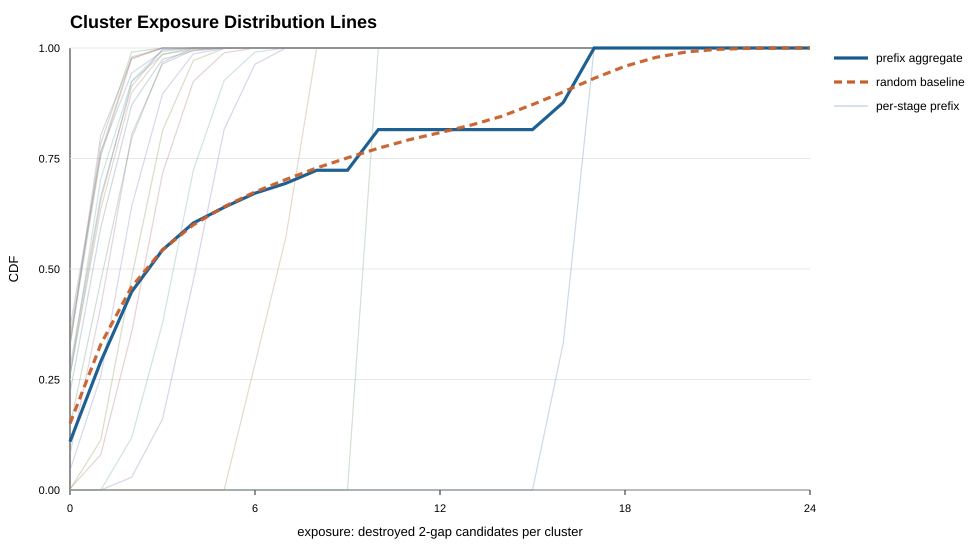
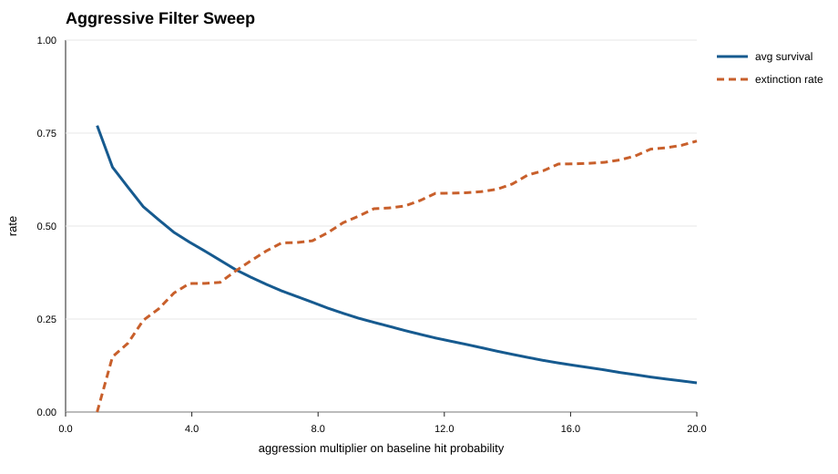

# Improvement Notes For `cluster-exposure-frontiers.md`

**Status:** Side note for editorial and mathematical cleanup. Not a
publication article.

These notes organize the latest improvement proposal for
[`cluster-exposure-frontiers.md`](cluster-exposure-frontiers.md), after
checking the companion/background notes:

- [`cluster-exposure-local-extinction.md`](cluster-exposure-local-extinction.md);
- [`../../../properties/sieve-sequence/fixed-shot-distance.md`](../../../properties/sieve-sequence/fixed-shot-distance.md);
- [`../../chapter7/survival-frontiers.md`](../../chapter7/survival-frontiers.md).

## 1. Keep The Evidence Boundary

The current draft is already careful about its status: finite prefix
measurement, companion simulation, and no asymptotic theorem for the real
sieve. Keep that boundary. It matches the survival-frontiers article's
distinction between exact companion identities, conditional asymptotic
derivations, empirical context, and formal-verification status.

The abstract, introduction, limitations, and conclusion should continue to say
that the cluster-exposure curves are finite empirical measurements and the
aggression sweep is a random companion experiment.

## 2. Make Companion Extinction Explicit

In Section 6, the extinction condition is currently mathematically clear, but
the prose can be sharper. The condition

```math
H_{p,\alpha}^{rand}(W)\ge N
```

is extinction in the random companion model, not a claim about the
deterministic sieve.

Suggested wording near the extinction definition:

```text
A cluster is extinct in the companion model when the simulated exposure
reaches the full cluster size. Since every candidate has been hit in that
simulation, the local companion population has no remaining 2-gap candidates.
```

This keeps the language aligned with the article's evidence boundary and with
the survival-frontiers companion framing.

## 3. Clarify Direct Versus Effective Survival

The previous concept note introduced effective exposure because endpoint
deletion can merge neighboring gaps and change the local environment. That
means the distinction in Section 4 is important and should remain.

The implementation also confirms the distinction:

- direct survival is label-based: original candidate 2-gaps not directly hit;
- effective survival is span-based: remove multiples of the stage head inside
  the original cluster span, then recount adjacent post-filter 2-gaps.

For the reported run, recomputing the rows gives:

```text
rows      = 54056
diff_rows = 0
```

where `diff_rows` counts rows with
`effective_survivors != cluster_size - exposure`.

So the draft should say the equality was row-level in this first measured run,
while preserving that it is empirical, not definitional.

Suggested replacement for the current equality statement:

```text
In this run, every measured cluster had effective survivor count equal to the
direct survivor count, so the row-level and aggregate direct/effective
statistics coincide. This is an empirical observation about the selected
prefixes and spans, not a general identity.
```

## 4. Make Repository Links Portable

The current SVG links use absolute local paths. That renders in Codex but is
not portable in GitHub or future article builds.

Suggested replacements:

```text


```

The license link should also be checked. From this folder,
`../../LICENSE` points to `articles/LICENSE`; `../../../LICENSE` points to the
repository root. Resolved 2026-10-07: `articles/LICENSE` is CC BY 4.0 and the
root `LICENSE` is MIT; the article declares CC BY 4.0, so the existing
`../../LICENSE` target is correct and stays.

## 5. Preserve The Density Refinement

Section 7 is the natural next step and should stay. It connects the empirical
row-level equality above to the missing measurement:

```math
D(W)/p
```

Stratifying exposure and extinction by local density is the right next
experiment if the goal is to identify where neighbor interference and merge
effects can become visible.

## 6. Suggested Edit Order

1. Replace the Section 4 equality paragraph with the row-level wording above.
   APPLIED 2026-10-07 — both Section 4 paragraphs now use row-level wording.
2. Add "in the companion model" to the Section 6 extinction prose.
   APPLIED earlier — Section 6 already carries the companion-model wording.
3. Convert absolute SVG links to relative links. DEFERRED — applied
   2026-10-07, then reverted the same day on review: the drafts folder and
   the `data/candidates/cluster-exposure-*` outputs are still untracked, so
   relative links would only resolve once the article and its data are
   committed and merged. Absolute local paths keep the draft renderable
   during editing. Apply the relative form as part of the commit/promotion
   unit of work.
4. Check whether the license should target `articles/LICENSE` or root
   `LICENSE`. RESOLVED 2026-10-07 — `../../LICENSE` (CC BY 4.0) is the
   correct target for the declared license; link unchanged.
5. Leave the density section in place as the explicit next measurement.
   UNCHANGED — still the next measurement.

Additional fixes applied 2026-10-07 in the same editorial pass, found by
verifying every reported number against the generated CSVs:

6. Section 6 extinction count corrected from approximately 39387 to exactly
   39384. The rate is an integer count over 54056 clusters, and
   `54056 * 0.7285777712 = 39384` exactly; the old value came from
   multiplying by the rounded rate `0.7286`.
7. Section 3 now records that the run-wide maximum adversariality is 5.36 at
   head 67, so the head-73 value 4.38 cannot be misread as the global
   maximum.
8. Section 5 now explains the staircase/mixture shape of the aggregate
   histogram: zero measured mass at exposures 9 and 11-15, the exposure-10
   spike contributed entirely by the head-5 stage (exposure always exactly
   10 there), and the 16-17 block contributed entirely by the head-3 stage
   (3325 + 6651 = 9976 = that stage's cluster count).
9. Limitations now states the stride-1 overlap: consecutive clusters share 24
   of their 25 candidates, so the 54056 rows are dependent sliding windows
   and the effective sample size behind the empirical CDF is much smaller
   than the row count.

No runtime validation is required for these note-only edits. If the main
article is edited later, markdown rendering/link checks are enough unless the
data or Python implementation changes.
